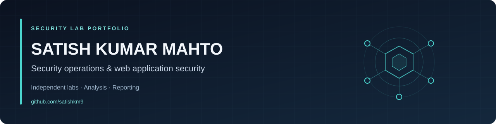

# Hi, I'm Satish Kumar Mahto

**Early-career cybersecurity professional · SOC analysis and VAPT**

I hold an **M.Sc. in Cybersecurity** and **CEH v12 certification**, with a **seven-month VAPT internship at Clovin Security**. My internship involved web application and network testing, vulnerability reporting, and remediation retesting.

I'm building a practical portfolio of security investigations, detection experiments, and application security assessments. Independent labs are presented as training, separately from professional experience.

[LinkedIn](https://www.linkedin.com/in/satishkrmahto/) · [Portfolio](https://satishkm009.github.io/portfolio/) · [Security lab portfolio](https://github.com/satishkm9/security-labs)

## Lab portfolio

[**Browse security-labs →**](https://github.com/satishkm9/security-labs)

A growing journal for TryHackMe, other training platforms, and my own lab environments. The repository starts with reusable templates; completed investigations will be added as I work through them.

| Area | Evidence I am building |
| --- | --- |
| SOC investigations | Alert context, log analysis, investigation timeline, verdict and escalation decisions |
| Detection practice | Original queries or rules, test data, expected results and false-positive analysis |
| Web and network security | Assessment scope, validated findings, remediation and retest notes |
| Digital forensics | Acquisition notes, artifact analysis and evidence-based timelines |

**Each completed entry will explain the problem, my contribution, the evidence, the result, and what I would improve.**

## Background

- **VAPT Engineer Intern — Clovin Security:** Dec 2024 – Jun 2025
- **Cyber and Digital Forensics Intern — CID Cyber Crime Police Station, Ranchi:** Sep – Dec 2021
- **M.Sc. Cybersecurity — Amity University, Rajasthan:** 2023 – 2025
- **CEH v12 — EC-Council**

## Tools used in internships and independent practice

| Focus | Tools and concepts |
| --- | --- |
| Monitoring and investigation | Splunk, ELK, Wazuh, Wireshark, log analysis, incident triage |
| Application and network testing | Burp Suite, Nmap, Nessus, OWASP ZAP, vulnerability validation |
| Forensics | FTK Imager, Autopsy, hash verification, incident timelines |
| Systems and scripting | Python, Bash, Linux, Windows |

## Current focus

- Develop repeatable SOC investigation and reporting skills.
- Test detection ideas against original or appropriately licensed sample data.
- Document application security findings with clear remediation and retesting.

**Open to junior SOC Analyst and VAPT Analyst opportunities.**
